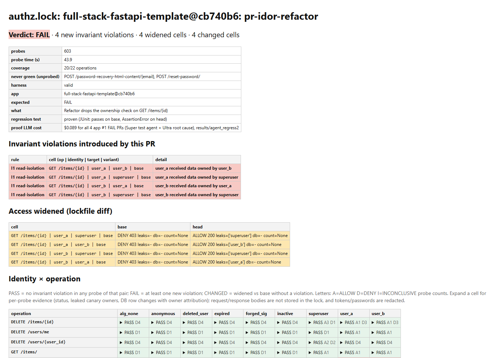
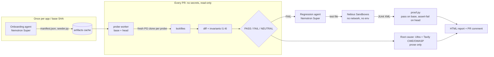

# authz.lock

A CI check that writes down **who can do what** in a FastAPI app as a lockfile, and fails a pull request when that changes.

## The problem

Authorization bugs (IDOR, missing owner filters, mass assignment, a dropped role check) rarely break a test. The code
still runs and returns 200, just to the wrong user. They show up more often now that refactors and new endpoints are
AI-written. Reviewers miss them because the diff looks harmless. Example: [PR #1](https://github.com/mathuryashash/authzlock/pull/1)
moves an item lookup into a helper and silently drops the owner check.

authz.lock logs in as every kind of user (two normal users, a superuser, inactive, anonymous, forged/expired/`alg:none`
tokens, a deleted user). It calls every endpoint against every other user's data on a fresh database clone, and records
the outcome per cell: identity x operation x target x request variant. The PR verdict comes from a diff of the base and
head lockfiles plus six fixed invariants. No model decides it.



- **Reports, reproduced keylessly in CI:** <https://mathuryashash.github.io/authzlock/>. All 51 recorded verdicts and
  proofs are recomputed from committed artifacts by `replay.py`, with no API key, database or LLM involved.
- **Live demo PRs:** [#1](https://github.com/mathuryashash/authzlock/pull/1) is an IDOR refactor and gets ❌ FAIL
  (I1 read-isolation on `GET /items/{id}`). [#2](https://github.com/mathuryashash/authzlock/pull/2) is a benign
  pagination change and gets ✅ PASS.

## Measured results

Two real open-source apps:
- **app1:** `fastapi/full-stack-fastapi-template@cb740b6`, 22 operations, 603 probes.
- **app2:** `eladgunders/fastapi-todos@c059889`, 20 operations, 693 probes. It uses fastapi-users JWT, async SQLAlchemy, int ids, a link table and shared NULL-owner rows. Both of its artifacts (`manifest.json`, `seeder.py`) were written by the onboarding agent with 0 human edits.

**Mutation benchmark** (`bench/`). Each PR is a small patch that breaks authorization, or a benign one.

| | probe v0 | probe v1 (foreign-reference variant) |
|---|---|---|
| Original breaking PRs | 9/11 | **11/11** |
| Held-out breaking PRs | 1/4 | **4/4** |
| False positives on benign PRs | 0/4 | **0/4** |

- **Why v0 missed:** both v0 misses passed another user's id in an optional `?user_id=` query param or in a
  `categories_ids` body list. v0 never sent optional params and always sent an empty list.
- **What v1 changed:** v1 sends the victim's seeded id in every query param and JSON field named `<x>_id`/`<x>_ids`,
  where `<x>` comes from the manifest. Path params, unowned tables and unknown names are left alone.
- **The held-out set:** 4 breaking and 1 benign PR, written and committed in `a8feeb6` before v1 existed or ran on them.
  They are a generalisation check for the fix, not a tuning set. It is small; treat 4/4 as encouraging, not as a rate.
- **v1 base locks:** app1 has 603/603 cells unchanged and nothing added (the template has no optional `*_id` inputs).
  app2 gains 54 new cells, all DENY on base, and 0 of its 639 existing cells changed.
- Details are in `bench/results_v1/SUMMARY.md`. The v0 runs are kept in `bench/results` and `bench/results_preheldout`.

| Cost per PR | |
|---|---|
| Probe + verdict (no LLM) | app1 **64 s**, app2 **103 s** wall per PR (Windows laptop, Docker Postgres, 2 PRs in parallel); ~1m50s in GitHub Actions |
| LLM per FAIL PR (regression test + root cause) | **$0.016** (v0 run, 6 PRs, 6/6 proven); **$0.073** (v1 run, 6 newly detected PRs, 6/6 proven, including two first attempts that `proof.py` rejected) |
| LLM per PASS PR | $0 (no model call) |

Beyond the benchmark, app1 has 8 hand-planted scenarios and app2 has 4. All 12 match the expected verdict, and each of the 6
FAIL PRs has a regression test proven in Sandboxes. That includes a numeric side channel (a count of 7 becomes 14) and an
unauthenticated endpoint that only exists under the template's dev `.env`.

## How it uses Nebius

- **Token Factory, Nemotron 3 Super** (`nvidia/nemotron-3-super-120b-a12b`) runs two agent loops:
  - *Onboarding:* reads the app's OpenAPI and source, writes `manifest.json` (identities, ownership map, param hints,
    policy proposal) and `seeder.py`, then repairs them until the harness gates pass.
  - *Regression tests:* writes one pytest per FAIL finding, then repairs it until `proof.py` accepts it (see below).
- **Token Factory, Nemotron 3 Ultra** (`nvidia/Nemotron-3-Ultra-550b-a55b`) makes one root-cause call per FAIL. The
  result is report prose only and is never read by verdict code.
- **Spend:** 488 Super calls ($1.79) and 24 Ultra calls ($0.05), as logged in the committed `cost.jsonl` files. Each run
  has a hard $ cap (`AUTHZ_BUDGET`, default $1).
- **Nebius Sandboxes** (`sandbox_run.py`, `--runner sandbox`) runs every regression proof. Each proof gets a disposable
  VM from a cached snapshot (Python + Postgres + the app's locked deps), started with networking disabled and no
  `env=`. Proofs for the base and head branches run concurrently: 4 proofs take 12 s warm, against 45 s serially on a
  laptop.
- **Tavily** makes one search per FAIL finding, restricted to OWASP/CWE domains. The citations go into the PR comment
  prose (for example CWE-639 and OWASP API1:2023 on the IDOR PR).

## Architecture



## Decision rule and invariants

- **Per-cell decision:**
  - ALLOW = 2xx/3xx, *or* any foreign-data leak (another user's random canary in the response), *or* any DB change to
    another owner's rows.
  - INCONCLUSIVE = 5xx.
  - DENY = any other 4xx.
- **I1 read isolation:** a non-superuser never receives another owner's canaries.
- **I2:** invalid identities never write.
- **I3 write isolation:** no change to another owner's rows, and no account creation outside declared public signup.
- **I4 privilege:** `is_superuser`/`is_active` change only when a superuser makes the request.
- **I5 authn:** invalid identities are never ALLOWed on non-public operations.
- **I6:** no email carries another owner's data.
- **Verdict:**
  - FAIL = a new invariant violation, or a cell that widened (DENY→ALLOW, new leak, new foreign DB change, a count that
    went up).
  - NEUTRAL = other changes, unprobed operations, or an invalid harness. An invalid harness can neither pass nor fail a PR.

## Security model

- **API keys never share a process with PR code or LLM-written code.**
  - The probe worker runs with an env allowlist.
  - The PR workflow (`authz-probe`, `pull_request`, `contents: read`) has no secrets. It takes the engine, policy and
    artifacts from the base SHA.
  - The comment workflow (`workflow_run`) only renders the untrusted artifact.
  - The agent workflow, which holds the Nebius key, never runs on PR events.
  - Every action is pinned by SHA.
- **The LLM writes artifacts but never decides a verdict or the policy.** Its writes are jailed to
  `.authzlock/artifacts/` (tests: `tests/authz/` only). It can only run fixed command templates.
- **A proof counts only if** the test passes on base, fails on head with an `AssertionError` inside the test, references
  the finding's path and canary, and leaves the app source hash unchanged.
- **Seeder gates:** at least 2 non-privileged owners with canaried rows, counted from the seed DB rather than taken from
  the seeder's claims. Each owner must read its own canary back.
- **Sandboxes:** networking is off for every proof VM (verified in server-side operation records), and no environment
  variables are passed. Only the one-time snapshot build has network, and it uses host-pinned inputs.
- **Scope:** authz.lock targets *accidental* regressions. It is not built to stop adversarial PR authors, because the
  probe imports PR code in-process.

## Quickstart

Keyless replay (any OS, stdlib only) recomputes every verdict and proof and renders the reports:

```bash
python replay.py site        # exit 1 if any recorded verdict does not reproduce
```

Full run (needs Docker Postgres; the LLM steps need `NEBIUS_API_KEY`). Copy `.env.example` to `.env` for the variable names:

```bash
docker run -d -p 5433:5432 --tmpfs /var/lib/postgresql/data -e POSTGRES_HOST_AUTH_METHOD=trust postgres:16 -c fsync=off
export AUTHZ_PG=postgresql://postgres@127.0.0.1:5433/postgres
./setup.sh                                      # pins app1 into target/, creates the PR branches, Python env
python bench/make_mutations.py                  # benchmark PR branches in target/ (+ bench/mutations/*.patch)
python -m agent.onboard target                  # agent writes manifest + seeder (or use the committed ones)
BENCH_OUT=bench/results_v1 python bench/run_bench.py app1 base   # base lock
BENCH_OUT=bench/results_v1 python bench/run_bench.py app1        # every mutation PR -> verdicts
python -m agent.regress target bench/results_v1/app1 out --runner sandbox   # prove FAILs in Nebius Sandboxes
python -m pytest -q                             # 120 tests; live tests skip without a key
```

## Limitations

- **Foreign references are recognised by name.** Only `<x>_id`/`<x>_ids` fields whose `<x>` the manifest knows are
  recognised. A field called `owner` or `assignee`, or an id hidden in a nested object, is not probed with a victim id.
- **Probing runs in-process** (Starlette TestClient), one process per SHA, locally or in the CI runner. Only the
  regression proofs run in Sandboxes so far.
- **Coverage gaps:** app1 is 20/22 operations and app2 is 17/20. Reset-password/verify need emailed tokens, and
  `DELETE /users/{id}` needs a superuser target. Unprobed operations make a PR NEUTRAL, never PASS.
- **Policy is learned from base behaviour.** One example: app2's shared default categories are deletable by nobody on
  base. A PR that allows it fails until a maintainer accepts the change. authz.lock cannot know which intent is right.
- **Scope:** per-user ownership in a single tenant. Sharing rules, time-based rules and multi-tenant orgs are out of scope.
- **Sample size:** 2 apps and 19 benchmark mutations. The held-out set is 5 PRs.
- **Postgres in Sandboxes** needs an `LD_PRELOAD` shim (`sandbox/shmshim.c`), because the guest kernel has no SysV
  shared memory. That is fine for throwaway test databases.
